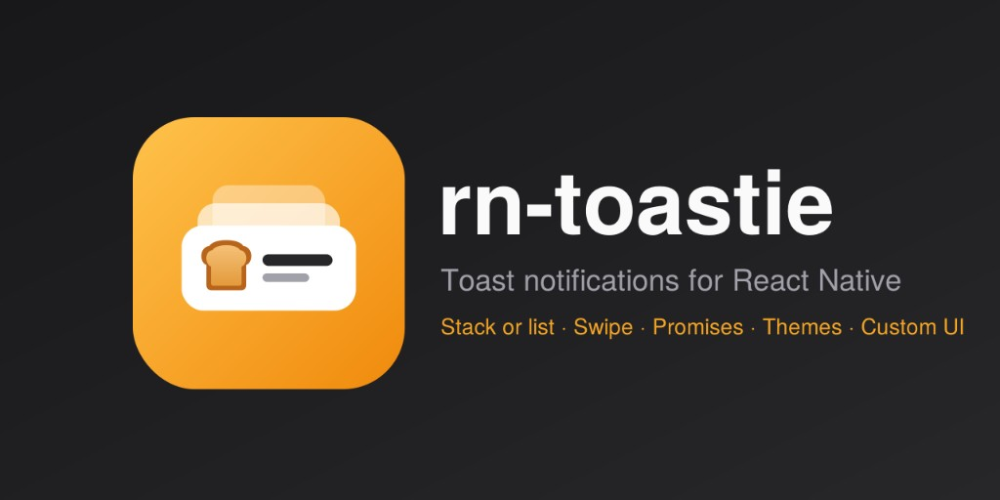

# rn-toastie

[](https://www.npmjs.com/package/rn-toastie)
[](https://www.npmjs.com/package/rn-toastie)
[](https://bundlephobia.com/package/rn-toastie)
[](https://github.com/akashdas99/rn-toastie/blob/main/LICENSE)
[](https://www.typescriptlang.org/)
[](https://reactnative.dev/)
[](https://expo.dev/)
[](https://github.com/akashdas99/rn-toastie)
[](https://snack.expo.dev/@akashdas5/rn-toastie)

<p align="center">
  
</p>

Swipeable, stackable toast notifications for React Native and Expo, built on Reanimated and
Gesture Handler.

- Stacked deck that expands on tap, or a plain list like react-toastify
- Swipe to dismiss, close button, action button
- Success, error, info, loading and promise toasts, plus fully custom components
- 8 positions with custom edge offsets, light/dark themes, configurable animations
- Accessible: screen-reader announcements, reduce-motion support, RTL

If rn-toastie is useful to you, [star it on GitHub](https://github.com/akashdas99/rn-toastie). It helps other people find it.

## Contents

- [Install](#install)
- [Setup](#setup)
- [Usage](#usage)
  - [Action button](#action-button)
  - [Promise](#promise)
  - [Loading + manual update](#loading--manual-update)
- [Methods](#methods)
- [Toaster props](#toaster-props)
- [Toast options](#toast-options)
- [Custom components](#custom-components)
- [Positions](#positions)
  - [Offset](#offset)
- [Stack order](#stack-order)
- [List mode](#list-mode-no-stacking)
- [Close button](#close-button)
- [RTL](#rtl)
- [Lifecycle](#lifecycle)
- [Named toasters](#named-toasters)
- [Theming](#theming)
  - [Different colors for light and dark](#different-colors-for-light-and-dark)
  - [Custom toasts](#custom-toasts)
- [Animation](#animation)
- [Progress bar](#progress-bar)
- [Haptics](#haptics)
- [Accessibility](#accessibility)
- [Keyboard](#keyboard)
- [Development](#development)

## Install

```bash
npm i rn-toastie
npx expo install react-native-reanimated react-native-worklets \
  react-native-gesture-handler react-native-safe-area-context
```
Works with Reanimated 3 (no `react-native-worklets`) and Reanimated 4 (needs `react-native-worklets`
and its Babel plugin, which `babel-preset-expo` sets up for you). Reanimated 3 and `react-native-worklets`
cannot be installed together.

## Setup

```tsx
import { GestureHandlerRootView } from 'react-native-gesture-handler';
import { SafeAreaProvider } from 'react-native-safe-area-context';
import { Toaster } from 'rn-toastie';

export default function App() {
  return (
    <GestureHandlerRootView style={{ flex: 1 }}>
      <SafeAreaProvider>
        <YourApp />
        <Toaster position="top" />
      </SafeAreaProvider>
    </GestureHandlerRootView>
  );
}
```

## Usage

```ts
import { toast } from 'rn-toastie';

toast('Saved');
toast.success('Payment complete', { description: 'Ref #12345' });
toast.error('Card declined', { duration: Infinity });
toast.dismiss();      // all
toast.dismiss(id);    // one
```

### Action button
```ts
toast('Message deleted', {
  action: { label: 'Undo', onPress: () => restoreMessage() },
  duration: 6000,
});
```

### Promise
```ts
toast.promise(api.pay(order), {
  loading: 'Processing payment...',
  success: (r) => `Paid ${r.amount}`,
  error: (e) => (e as Error).message,
});
```
Also accepts a function (`() => api.pay(order)`). Returns the original promise.

### Loading + manual update
```ts
const id = toast.loading('Uploading...');
toast.update(id, { title: 'Uploaded', type: 'success', duration: 4000 });
```
`update` accepts `title`, `description`, `type`, `duration`, `action`, `icon` and `render`,
and restarts the countdown.

## Methods

| Method | Description |
| --- | --- |
| `toast(content, options?)` | Show a toast. `content` is a string or a custom component. Returns the id |
| `toast.success / error / info (content, options?)` | Same, with that type |
| `toast.loading(content, options?)` | Spinner icon, stays until updated or dismissed |
| `toast.custom(render, options?)` | Custom component (see [Custom components](#custom-components)) |
| `toast.promise(promise, messages, options?)` | Loading, then success or error. Returns the promise |
| `toast.update(id, patch)` | Change a toast that is on screen |
| `toast.dismiss(id?)` | Dismiss one toast, or all when no id is given |
| `toast.clear(toasterId?)` | Dismiss every toast in one toaster, or in all toasters |

Each toast runs its own timer, so the oldest leaves first.

## Toaster props

| Prop | Default | Description |
| --- | --- | --- |
| `id` | `'default'` | Name of this toaster. Target it with `toast('..', { toasterId })` |
| `position` | `'top'` | One of the eight [positions](#positions) |
| `offset` | `{ top: 8, bottom: 8, left: 16, right: 16 }` | Distance (px) from the screen edges, see [Offset](#offset) |
| `maxWidth` | `380` | Max toast width (px) for the left, center and right positions |
| `stacked` | `true` | Collapsed deck that expands on tap. `false` = [list mode](#list-mode-no-stacking) |
| `maxVisible` | `3` stacked, unlimited in list mode | How many toasts show at once |
| `newestOnTop` | `false` | Put the newest toast above the older ones (see [Stack order](#stack-order)) |
| `peek` | `12` | Vertical peek (px) of each card behind the front one |
| `peekSide` | top: `bottom`, bottom: `top` | Collapsed deck only: peek lower (`bottom`) or higher (`top`) on the screen |
| `peekScale` | `0.05` | Scale reduction per level in the collapsed deck |
| `gap` | `8` | Gap (px) between toasts when expanded or in list mode |
| `closeButton` | `true` | Close (x) button on built-in toasts |
| `showProgress` | `true` | Countdown bar on auto-dismissing toasts |
| `theme` | `'system'` | `'light'`, `'dark'` or `'system'` |
| `themeOverrides` | | Override any [theme](#theming) value, or `{ light, dark }` for each scheme |
| `animation` | | Enter, exit, restack and swipe motion (see [Animation](#animation)) |
| `haptics` | | `(event) => void`, see [Haptics](#haptics) |
| `rtl` | `I18nManager.isRTL` | Mirror the layout and progress bar |
| `avoidKeyboard` | `true` on iOS, `false` on Android | Lift a bottom toaster above the keyboard |
| `keyboardOffset` | `0` | Extra gap (px) above the keyboard when `avoidKeyboard` is on |

## Toast options

| Option | Default | Description |
| --- | --- | --- |
| `description` | | Second line of text |
| `type` | `'default'` | `'default'`, `'success'`, `'error'`, `'info'` or `'loading'` |
| `duration` | `4000` (`Infinity` for loading) | ms until auto-dismiss. `Infinity` = never |
| `action` | | `{ label, onPress }` button. Pressing it runs `onPress`, then dismisses |
| `icon` | | Custom `ReactNode` replacing the built-in icon (and the loading spinner) |
| `closeButton` | Toaster's `closeButton` | Show the close (x) button. Never shown on custom toasts |
| `onOpen` | | Called once when the toast appears |
| `onDismiss` | | Called once after the toast leaves the screen, for any reason |
| `toasterId` | `'default'` | Which `<Toaster id>` shows it |
| `animation` | Toaster's `animation` | Per-toast override (see [Animation](#animation)) |
| `unstyled` | `false` | Custom toasts: remove the card background, border, padding and shadow |
| `expandOnTap` | `true`, `false` for custom | Tap toggles the deck |
| `accessibilityLabel` | title and description | Screen-reader text. Recommended for custom toasts |
| `id` | auto | Reuse an id to replace an existing toast |

## Custom components
Pass any React element, or a function that returns one, instead of a string:

```tsx
// Same as toast.custom(<Banner />)
toast(<Banner />);

toast.custom(({ id, dismiss, update, theme }) => (
  <UploadCard
    onCancel={dismiss}
    onDone={() => update({ render: <Text>Uploaded</Text> })}
    textColor={theme.title}
  />
), { duration: Infinity, accessibilityLabel: 'Uploading file' });

// Full control over the look: no background, border, padding or shadow
toast.custom(<PromoCard />, { unstyled: true });
```

- Your component renders inside the stack, so swipe-to-dismiss, stacking, expanding, auto-dismiss and
  haptics still work. The height is measured, so any size is fine.
- A function render is called inside a component, so hooks are allowed in it.
- `ctx` gives you `id`, `type`, `theme`, `dismiss()` and `update(patch)`. `update({ render })` swaps the content.
- Tapping a custom toast does **not** expand the deck by default, so buttons inside it never double-fire.
  Set `expandOnTap: true` if your content has no buttons.
- Set `accessibilityLabel`. Without it a screen reader reads the text inside your component, but iOS
  won't announce the toast when it appears.
- `unstyled` also hides the progress bar. Pass `duration: Infinity` to keep the toast until dismissed.

## Positions
Eight positions: `top`, `bottom` (full width) and `top-left`, `top-center`, `top-right`,
`bottom-left`, `bottom-center`, `bottom-right` (fixed width, set with `maxWidth`, default 380).
```tsx
<Toaster position="bottom-right" maxWidth={360} />
```
Left and right are physical edges, also in RTL. On a phone the aligned positions look almost like
the full-width ones, so they matter mostly on tablets and foldables.

### Offset
Move the stack away from the screen edges, for example below a custom header or above a tab bar.
Offsets are measured inside the safe area, so you don't need to add the notch or home indicator.
```tsx
<Toaster position="top" offset={{ top: 64 }} />            // below a 64px header
<Toaster position="bottom" offset={{ bottom: 72 }} />      // above a tab bar
<Toaster position="bottom-right" offset={24} />            // 24px from every edge
```
A number sets all four sides. In an object, sides you leave out keep their defaults
(`top` and `bottom` 8, `left` and `right` 16). On a bottom toaster the keyboard lift still
applies, and the offset is added above the keyboard.

## Stack order
`newestOnTop` controls list order and which toast sits on the screen edge. By default a new toast
goes below the older ones (on a bottom toaster it stays on the bottom edge and pushes older ones
up). Set `newestOnTop` to put the newest at the edge on top toasters instead.
```tsx
<Toaster position="top" newestOnTop />
```
The front card of the collapsed deck is always the toast at that edge, same as the list.

`peekSide` only changes which way the deck peeks behind that front card. It does not change order.
```tsx
<Toaster position="top" peekSide="top" />   {/* cards peek upward behind the front toast */}
```

## List mode (no stacking)
Show toasts one below the other at full size, like react-toastify:
```tsx
<Toaster stacked={false} />                 // unlimited
<Toaster stacked={false} maxVisible={4} />  // extra toasts wait until there is room
```
Tapping does nothing in list mode and timers never pause. Toasts waiting beyond `maxVisible`
start their countdown once they appear. Combine with `newestOnTop` to choose where new ones go.

## Close button
Every built-in toast has a close (x) button. Turn it off for a toaster or for one toast.
Custom toasts never get one, since they control their own layout.
```tsx
<Toaster closeButton={false} />
toast('Saved', { closeButton: false });
```

## RTL
```tsx
<Toaster rtl />   // defaults to I18nManager.isRTL
```
Mirrors the icon, text and action button order and starts the progress bar from the other side.
Text alignment still follows the script of the text.

## Lifecycle
```ts
toast('Saved', {
  onOpen: () => analytics.track('toast_shown'),     // once, when it appears
  onDismiss: () => analytics.track('toast_closed'), // once, after it leaves the screen
});
```
`onOpen` does not fire again when you reuse an `id` to replace a toast that is still visible.

## Named toasters
Run several independent stacks, for example one on top for errors and one at the bottom.
```tsx
<Toaster />                                 {/* id "default" */}
<Toaster id="bottom" position="bottom" />

toast.info('Hi', { toasterId: 'bottom' });
toast.clear('bottom');                      // dismiss one toaster only
```
`Modal` content renders in its own native window, so mount a `<Toaster id="modal" />`
inside the Modal and target it with `toasterId: 'modal'`.

## Theming
`theme` picks the scheme: `'system'` (default) follows the device, `'light'` and `'dark'` force one.
`themeOverrides` changes any value; keys you leave out keep the built-in value.
```tsx
<Toaster
  theme="system"   // 'light' | 'dark' | 'system'
  themeOverrides={{ colors: { success: '#10B981' } }}   // applies to both schemes
/>
```

### Different colors for light and dark
Pass `{ light, dark }` to override each scheme separately. With `theme="system"` the matching one
is used as the device switches.
```tsx
const overrides = {
  light: { colors: { success: '#059669' } },
  dark: { background: '#0B1220', border: '#1E293B', colors: { success: '#34D399' } },
};

<Toaster theme="system" themeOverrides={overrides} />
```
Define the object outside render (or `useMemo` it) so it keeps the same reference.
| Key | Used for |
| --- | --- |
| `background` | Card background |
| `border` | Card border |
| `title` | Title text (and the loading spinner) |
| `description` | Description text and the close (x) icon |
| `actionBackground` | Action and close button background |
| `actionText` | Action button text |
| `colors` | Per-type color for the icon and progress bar: `default`, `success`, `error`, `info`, `loading` |

`darkTheme` and `lightTheme` are exported if you want to read the defaults or extend them.

### Custom toasts
The render function gets the active theme, so your component follows light and dark mode too:
```tsx
toast.custom(({ theme }) => (
  <View style={{ backgroundColor: theme.background }}>
    <Text style={{ color: theme.title }}>Synced</Text>
    <Text style={{ color: theme.description }}>All changes saved</Text>
  </View>
));
```

## Animation
Set it on the Toaster, and override it for a single toast with the `animation` option.
```tsx
<Toaster animation={{ preset: 'scale', spring: { damping: 22 } }} />

toast.error('Card declined', { animation: { preset: 'fade', exitDuration: 150 } });
```

| Preset | Enter / exit |
| --- | --- |
| `slide` (default) | Slides in from the toaster's edge |
| `fade` | Fades in place |
| `scale` | Fades and grows from `enterScale` |
| `none` | Appears and disappears instantly |

| Option | Default | Description |
| --- | --- | --- |
| `preset` | `'slide'` | Enter/exit motion, see the table above |
| `type` | `'spring'` | `'spring'` or `'timing'` for enter and restack motion |
| `spring` | `{ damping: 18, stiffness: 180, mass: 0.8 }` | Spring config |
| `enterDuration` | `300` | Enter/restack ms when `type` is `'timing'` |
| `exitDuration` | `220` | Exit ms |
| `restackDuration` | `180` | Fade ms when a toast enters or leaves the visible deck |
| `swipeOutDuration` | `180` | Fly-out ms after a swipe |
| `easing` | `Easing.out(Easing.cubic)` | Timing easing; use Reanimated's `Easing` |
| `enterDistance` | `120` | `slide` travel in px |
| `enterScale` | `0.85` | `scale` starting scale |
| `swipeEnabled` | `true` | Swipe to dismiss |
| `swipeDirections` | left, right, toward the edge | Any of `'left' \| 'right' \| 'up' \| 'down'` |
| `swipeThreshold` | `{ x: 80, y: 40 }` | px a swipe must travel to dismiss |
| `rubberBand` | `0.15` | Drag resistance in directions that don't dismiss |
| `reduceMotion` | `'system'` | `'always'` / `'never'` override the OS setting |

`defaultAnimation` is exported. Define the `animation` object outside render (or `useMemo` it) so
it keeps the same reference between renders.

## Progress bar
On by default for auto-dismissing toasts. It pauses together with the timer while the deck
is expanded. Turn it off with `<Toaster showProgress={false} />`.

## Haptics
Bring your own library. Events: `show`, `success`, `error`, `dismiss`.
```tsx
import * as Haptics from 'expo-haptics';

<Toaster
  haptics={(e) => {
    if (e === 'success') Haptics.notificationAsync(Haptics.NotificationFeedbackType.Success);
    else if (e === 'error') Haptics.notificationAsync(Haptics.NotificationFeedbackType.Error);
    else Haptics.impactAsync(Haptics.ImpactFeedbackStyle.Light);
  }}
/>
```

## Accessibility
- Each toast is an `alert` with a live region (`assertive` for errors, `polite` otherwise);
  iOS gets an explicit VoiceOver announcement.
- Custom screen-reader actions: **Dismiss**, plus the action button's label when present.
- Toasts hidden behind the front one are removed from the accessibility tree until the deck is expanded.
- Honors the OS "reduce motion" setting (springs become short fades).

## Keyboard
`<Toaster position="bottom" avoidKeyboard />` lifts the stack above the keyboard.
Default is on for iOS and off for Android, where `adjustResize` already moves the window.
Set it explicitly if your Android setup differs (for example edge-to-edge).
Add space between the toast and the keyboard with `keyboardOffset` (it does not apply when
the keyboard is hidden; use `offset.bottom` for a permanent bottom inset).
```tsx
<Toaster position="bottom" avoidKeyboard keyboardOffset={12} />
```

## Development
```bash
npm install
npm test
npm run typecheck
npm run build      # react-native-builder-bob -> lib/commonjs, lib/module, lib/typescript
```
Run the demo with the Expo app in `example/`.
